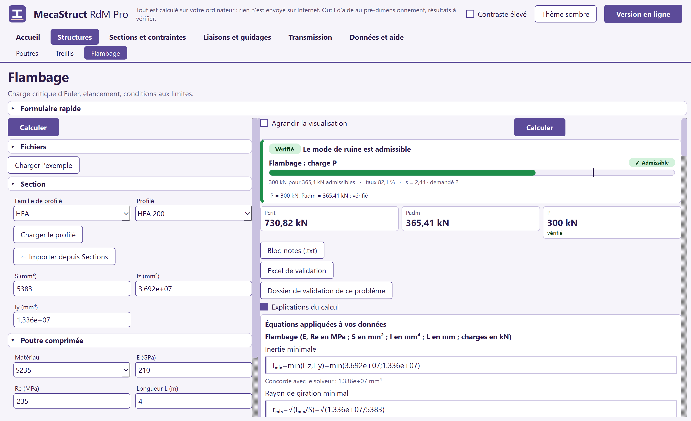
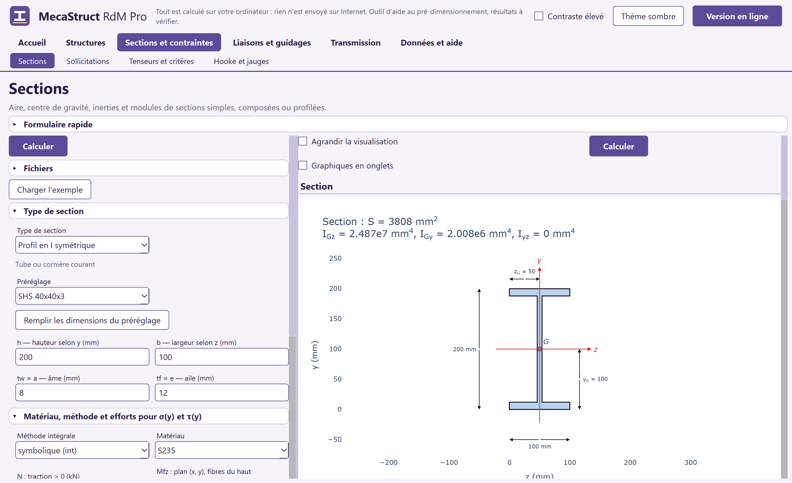
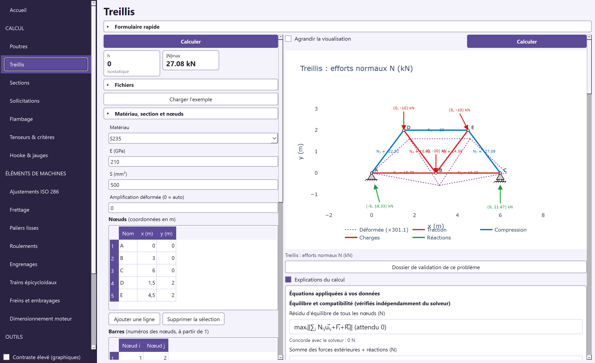
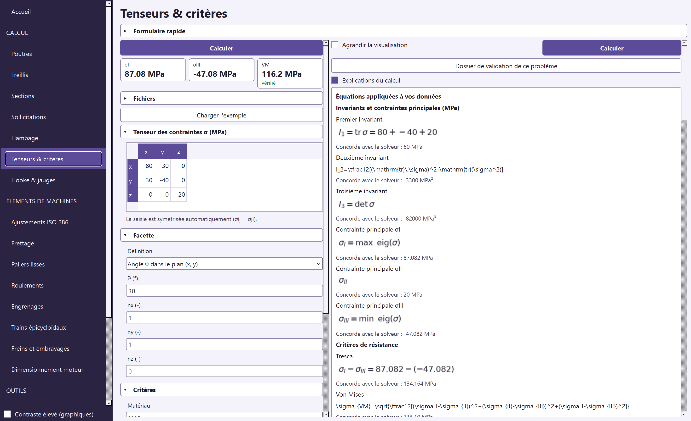
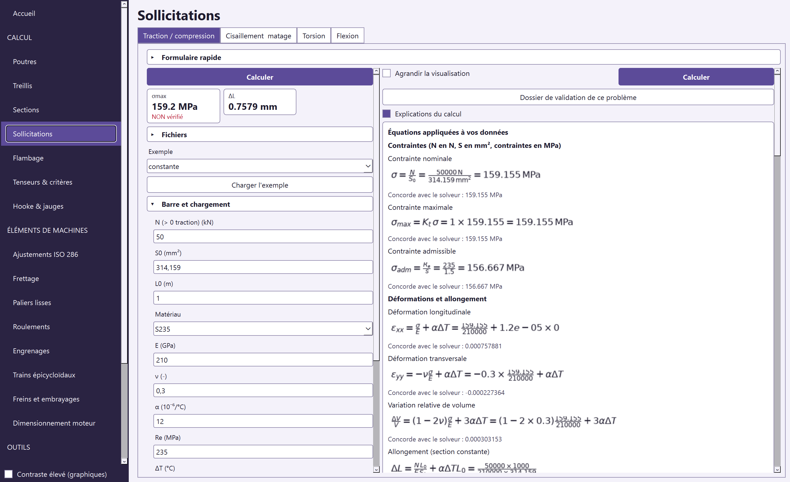
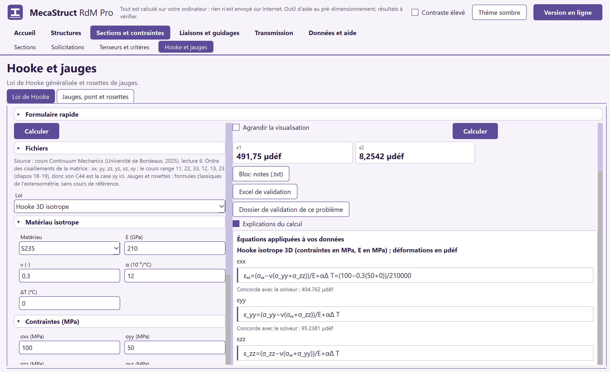

<div align="center">

# 🏗️ MecaStruct RdM

### Cette pièce tient-elle, et avec quelle marge ?

Résistance des matériaux et éléments de machines : un **verdict en toutes lettres**, les **formules remplies avec vos valeurs**
et un dossier qui **refait le calcul à la main**. Tout est calculé dans votre navigateur.

[](https://theo33-oss.github.io/MecaStruct/)
[](https://github.com/theo33-oss/MecaStruct/releases/latest)

[](https://github.com/theo33-oss/MecaStruct/actions/workflows/tests.yml)
[](https://github.com/theo33-oss/MecaStruct/releases/latest)
[](LICENSE)


</div>

## ✨ Pourquoi MecaStruct

| | |
|---|---|
| ✅ **Un verdict clair** | « Conforme » ou non, avec le taux de travail et le coefficient de sécurité obtenu face à celui demandé. |
| 🧮 **Le calcul sous les yeux** | Chaque page affiche les formules remplies avec vos valeurs, pas à pas. |
| 📝 **Un dossier justifié** | Le dossier de validation refait chaque grandeur à la main ; l'Excel de validation la refait par des formules. |
| 🔒 **Rien ne sort de chez vous** | Aucun serveur, aucun cookie : tout est calculé sur votre poste. |

## ⚡ Essayer en 1 minute

1. Ouvrez le **[site](https://theo33-oss.github.io/MecaStruct/)** (15 à 30 s au premier chargement, Internet nécessaire).
2. Cliquez sur **Commencer par un ajustement ISO 286** : un exemple déjà calculé s'ouvre.
3. Changez le diamètre ou la qualité : le résultat suit. À 50 mm, le serrage passe de -50 à -9 µm.
4. Ouvrez **Explications du calcul**, puis exportez en **Bloc-notes** ou **Excel de validation**.

## 🖼️ En images

<table>
  <tr>
    <td align="center"><br><b>Flambage</b></td>
    <td align="center"><br><b>Sections</b></td>
    <td align="center"><br><b>Treillis</b></td>
  </tr>
  <tr>
    <td align="center"><br><b>Tenseurs et critères</b></td>
    <td align="center"><br><b>Sollicitations</b></td>
    <td align="center"><br><b>Hooke et jauges</b></td>
  </tr>
</table>

## 🧭 Ce qu'il y a dedans

| Famille | Pages |
|---|---|
| 🏗️ Structures | **Poutres** (2D, ossature 3D, Eurocode 3, fatigue, charge mobile), **Treillis**, **Flambage** |
| 📐 Sections et contraintes | **Sections**, **Sollicitations**, **Tenseurs et critères**, **Hooke et jauges** |
| ⚙️ Liaisons et guidages | **Ajustements ISO 286**, **Frettage**, **Paliers lisses**, **Roulements** |
| 🔧 Transmission | **Engrenages**, **Freins et embrayages**, **Dimensionnement moteur** |
| 📚 Données et aide | **Convertisseur**, **Matériaux et profilés**, **Références**, **Limites et vérifications** |

## 💻 Navigateur ou bureau

| | Navigateur | Bureau (Windows) |
|---|---|---|
| Installation | aucune | un installateur |
| Démarrage | 15 à 30 s la première fois | quelques secondes |
| Internet | au premier chargement | jamais |
| En plus | lien de partage d'une étude | dossiers PDF et Word |

Même menu, mêmes pages, même calcul. Une étude enregistrée dans l'une s'ouvre dans l'autre.

## ⚠️ Limites et avertissement

MecaStruct est un **outil pédagogique et d'aide au pré-dimensionnement**, fourni **sans garantie** :
vérifiez les résultats avant tout usage réel. Le calcul est contrôlé par plus de 1 300 tests et par des recalculs à la main
de formules de manuel. Ce qui est vérifié, et ce qui ne l'est pas, est écrit dans [LIMITES.md](LIMITES.md) ;
les cours et normes cités sont dans la page Références. Les changements de version : [CHANGELOG.md](CHANGELOG.md).

## 🛠️ Pour les développeurs

```bash
cd application
python -m venv .venv
.venv\Scripts\pip install -r requirements.lock pytest pytest-qt
.venv\Scripts\python main.py                   # application de bureau
.venv\Scripts\python -m pytest -q -m "not qt"  # tests du calcul (environ 2 min)
```

| Dossier | Contenu |
|---|---|
| `application/mecastruct/core`, `services`, `plots` | le calcul, sans interface |
| `application/mecastruct/bureau` | l'application de bureau (PySide6) |
| `application/mecastruct/pont` | le lien entre le site et le calcul (JSON) |
| `application/data`, `application/tests` | tables (matériaux, profilés, ISO 286) et tests |
| `docs/` | le site publié par GitHub Pages |

Le site charge le même code Python avec [Pyodide](https://pyodide.org) ; `python construire_web.py` le régénère.
`python construire_bureau.py` fabrique l'application autonome ; une étiquette `v*` sur GitHub la publie.

## 👤 Auteur et licence

Projet de **Théo Brun**, portage en Python de son application MATLAB de résistance des matériaux.
Du même auteur : [Chaînes de cotes 1D](https://github.com/theo33-oss/chaines-de-cotes-1D).
Licence [PolyForm Noncommercial 1.0.0](LICENSE) : usage non commercial libre, usage commercial sur autorisation écrite.

---

## 🇬🇧 In English

**MecaStruct RdM** is a free strength-of-materials and machine-element calculator (beams, trusses, sections, buckling,
ISO 286 fits, shrink fits, bearings, gears, brakes, motor sizing). It gives a plain-language verdict, the formulas
filled in with your values, and a hand-calculation report. Everything runs locally in your browser (Pyodide) or in a
Windows desktop app; nothing is sent to a server.
**Educational and pre-sizing tool, provided without warranty: always check the results.** Interface and docs are in French.
Licence: PolyForm Noncommercial 1.0.0.
