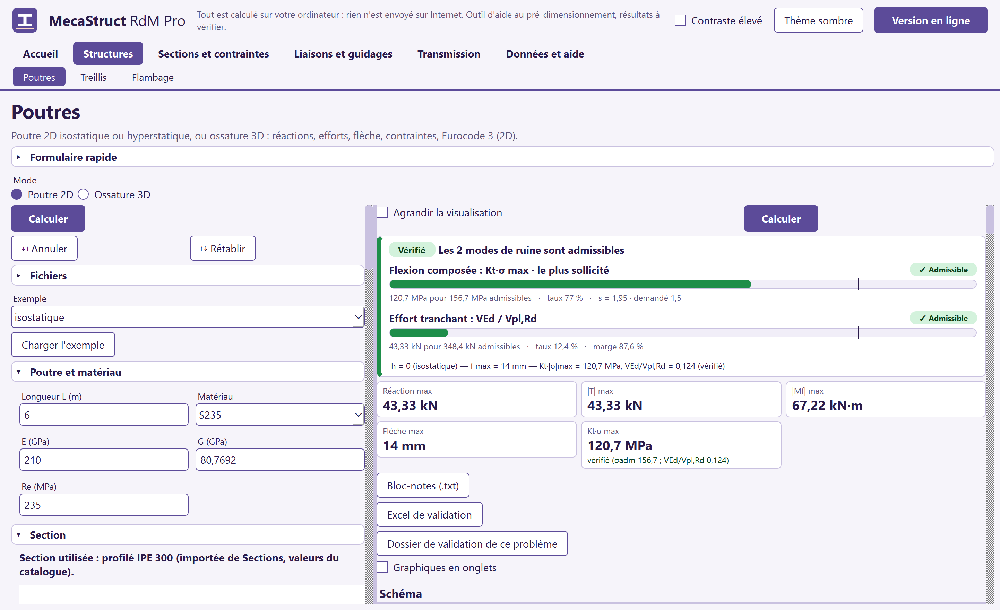

# MecaStruct RdM Pro

**Cette pièce tient-elle, et avec quelle marge ?** MecaStruct calcule la résistance des matériaux et les éléments de
machines (poutres, treillis, sections, flambage, ajustements, frettage, roulements, engrenages, freins, moteur) et
répond par un verdict, les formules remplies avec vos valeurs et un dossier qui refait le calcul à la main.

[](https://theo33-oss.github.io/MecaStruct/)
[](https://github.com/theo33-oss/MecaStruct/releases/latest)
[](https://github.com/theo33-oss/MecaStruct/actions/workflows/tests.yml)
[](https://github.com/theo33-oss/MecaStruct/releases/latest)
[](LICENSE)



## À quoi ça sert

- Vérifier une pièce ou une structure. Le résultat s'ouvre sur un verdict en toutes lettres et un diagramme des modes
  de ruine, avec le taux de travail et le coefficient de sécurité obtenu face à celui demandé.
- Comprendre le calcul. Chaque page affiche les formules remplies avec vos valeurs et la démarche pas à pas.
- Justifier le résultat. Le dossier de validation refait chaque grandeur à la main (pages de RdM), et l'Excel de
  validation refait le calcul par des formules.
- Reprendre les chiffres ailleurs, avec des tableaux à copier dans Excel et un export bloc-notes.

## Essayer en 1 minute

1. Ouvrez le [site](https://theo33-oss.github.io/MecaStruct/). Le premier chargement prend 15 à 30 secondes
   (Internet nécessaire), les suivants quelques secondes.
2. Cliquez sur **Commencer par un ajustement ISO 286**. La page s'ouvre sur un exemple déjà calculé,
   « Ajustement 100 H7/r6 serré : jeu de -73 à -16 µm ».
3. Changez le diamètre, la lettre ou la qualité, le résultat suit. À 50 mm, le serrage passe de -50 à -9 µm.
4. Sous le résultat, les onglets **Graphique**, **Synthèse** et **Explications du calcul** détaillent le calcul.
   **Bloc-notes (.txt)** et **Excel de validation** l'exportent.
5. **Enregistrer l'étude** garde vos valeurs dans un fichier, **Copier le lien de l'étude** les met dans une adresse à
   partager.

## Deux façons de l'utiliser

| | Dans le navigateur | Sur le bureau (Windows) |
|---|---|---|
| Installation | aucune | un installateur à télécharger |
| Démarrage | 15 à 30 secondes la première fois | quelques secondes |
| Internet | au premier chargement | jamais après l'installation |
| Données | restent dans votre navigateur | restent sur votre ordinateur |
| En plus | lien de partage d'une étude, hors ligne après la première visite | dossiers PDF et Word, démarrage immédiat |

Dans les deux cas, rien n'est envoyé à un serveur : tout est calculé sur votre poste. Les deux versions ont le même
menu, les mêmes pages et le même calcul. Une étude enregistrée sur le site (pages de RdM) s'ouvre dans l'application
de bureau, et inversement.

## Contenu

Le menu a cinq familles, sur le site comme sur le bureau.

| Famille | Pages |
|---|---|
| Structures | **Poutres** (poutre 2D ou ossature 3D, combinaisons, Eurocode 3, fatigue, charge mobile, profilé le plus léger), **Treillis**, **Flambage** |
| Sections et contraintes | **Sections**, **Sollicitations** (traction, cisaillement, torsion, flexion), **Tenseurs et critères**, **Hooke et jauges** |
| Liaisons et guidages | **Ajustements ISO 286**, **Frettage**, **Paliers lisses**, **Roulements** |
| Transmission | **Engrenages** (engrènement, train simple, train épicycloïdal), **Freins et embrayages**, **Dimensionnement moteur** |
| Données et aide | **Convertisseur**, **Matériaux et profilés** (abaques Kt, ajouts gardés dans le navigateur), **Références**, **Limites et vérifications** |

Deux écarts entre les versions : sur le bureau, le train épicycloïdal a sa propre page (un onglet d'Engrenages sur le
site), et « À propos » est une page du menu (en pied de page sur le site).

## Fiabilité et limites

Les moteurs viennent d'une application MATLAB et sont comparés à ses résultats par plus de 1 300 tests.
Ce qui est vérifié, et ce qui ne l'est pas, est écrit dans [LIMITES.md](LIMITES.md). Les cours et normes cités sont
listés dans la page Références de l'application (établissements et années tels qu'imprimés) ; plus de 20 exemples
chiffrés de ces cours sont des tests (`application/tests/test_cours.py`).

Outil pédagogique et d'aide au pré-dimensionnement, fourni sans garantie : vérifiez les résultats avant tout usage
réel. Ce qui change d'une version à l'autre est dans [CHANGELOG.md](CHANGELOG.md).

## Pour les développeurs

```bash
cd application
python -m venv .venv
.venv\Scripts\pip install -r requirements.lock pytest pytest-qt
.venv\Scripts\python main.py                  # application de bureau
.venv\Scripts\python -m pytest -q -m "not qt"  # tests du calcul (environ 2 min)
```

| Dossier | Contenu |
|---|---|
| `application/mecastruct/core`, `services`, `plots` | le calcul, sans aucune interface |
| `application/mecastruct/bureau` | l'application de bureau (PySide6) |
| `application/mecastruct/pont` | le lien entre le site et le calcul (entrées et sorties en JSON) |
| `application/data`, `application/tests` | tables (matériaux, profilés, ISO 286) et tests |
| `docs/` | le site publié par GitHub Pages |

Le site charge le même code Python dans le navigateur avec [Pyodide](https://pyodide.org) ; `python construire_web.py`
le régénère après une modification. `python construire_bureau.py` fabrique l'application autonome et l'installateur ;
sur GitHub, une étiquette `v*` les publie dans les Releases.

## Auteur et licence

Projet de **Théo Brun**, portage en Python de son application MATLAB de résistance des matériaux.
Du même auteur : [Chaînes de cotes 1D](https://github.com/theo33-oss/chaines-de-cotes-1D), le calcul des jeux d'un
assemblage, bâti de la même façon (site et application de bureau).

Licence [PolyForm Noncommercial 1.0.0](LICENSE) : usage non commercial autorisé ; usage commercial sur autorisation
écrite préalable de l'auteur.
